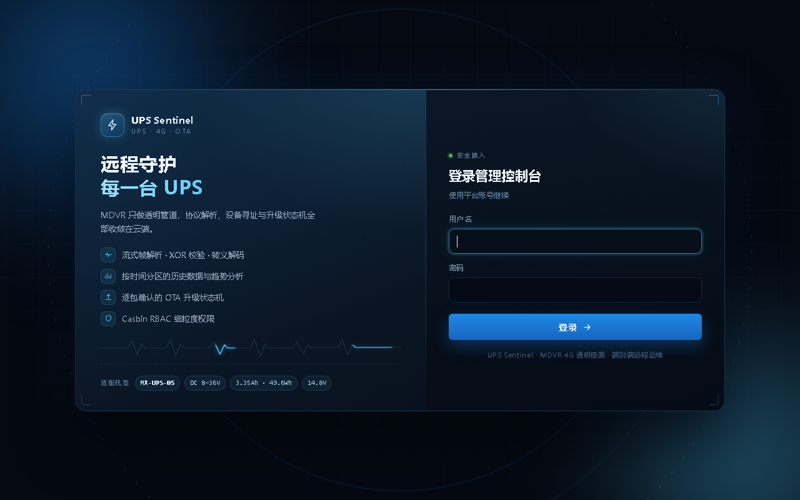
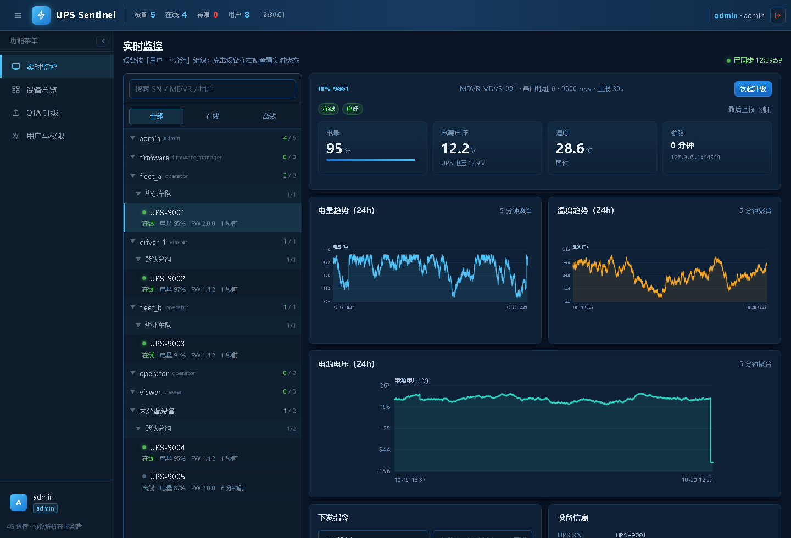
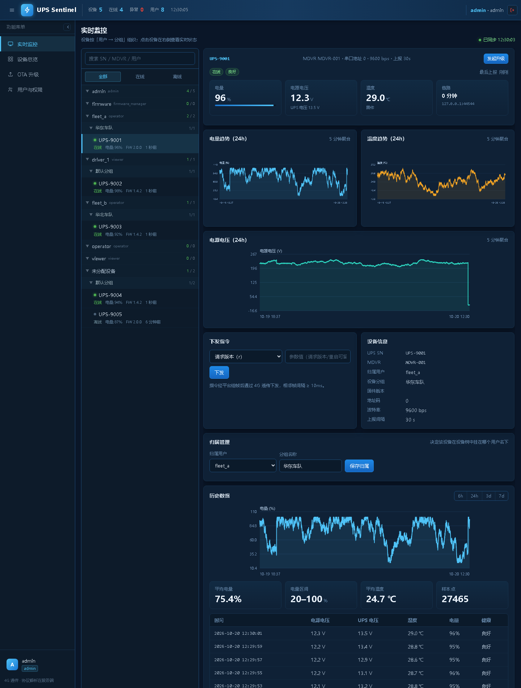
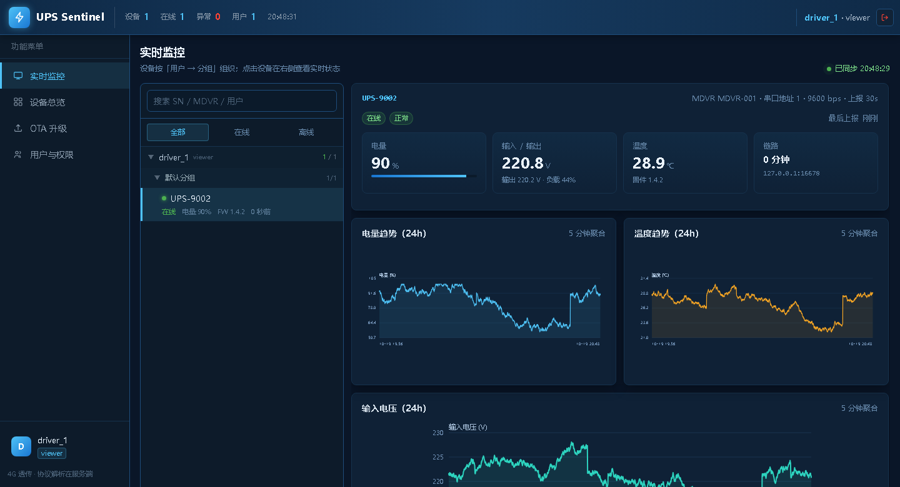
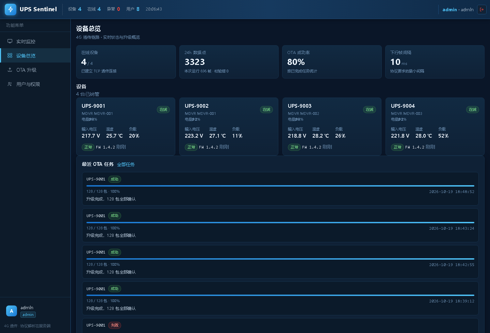
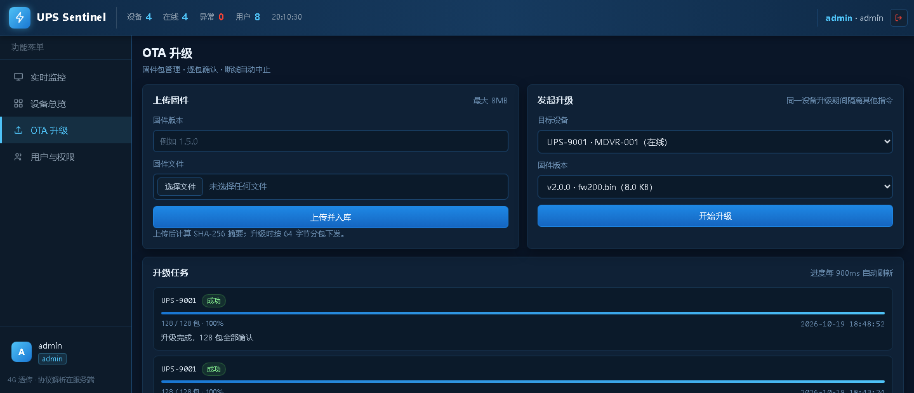
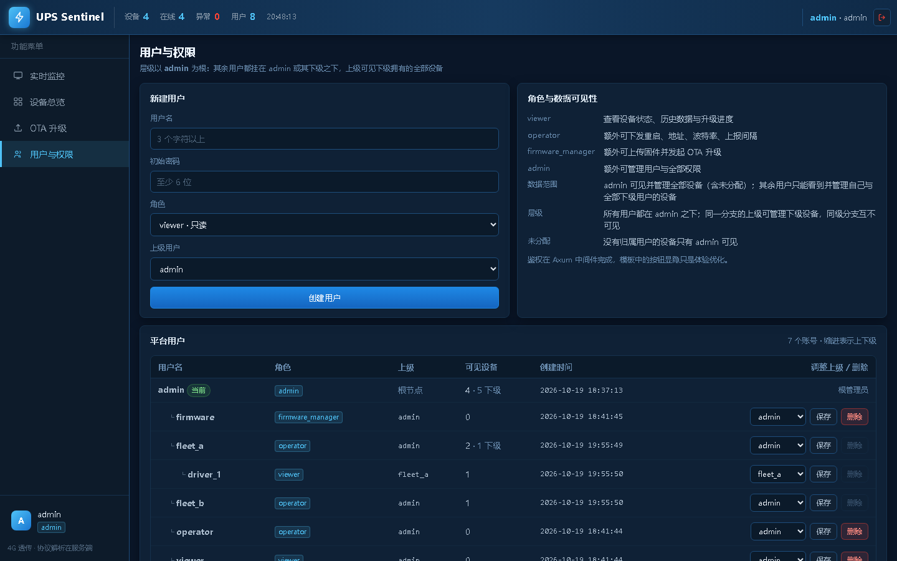
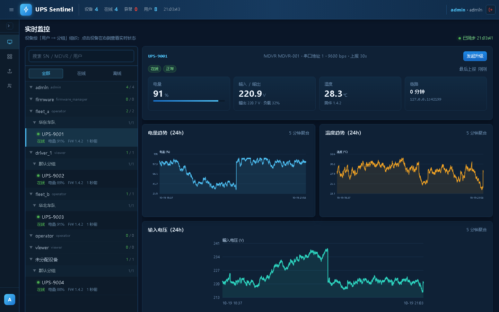
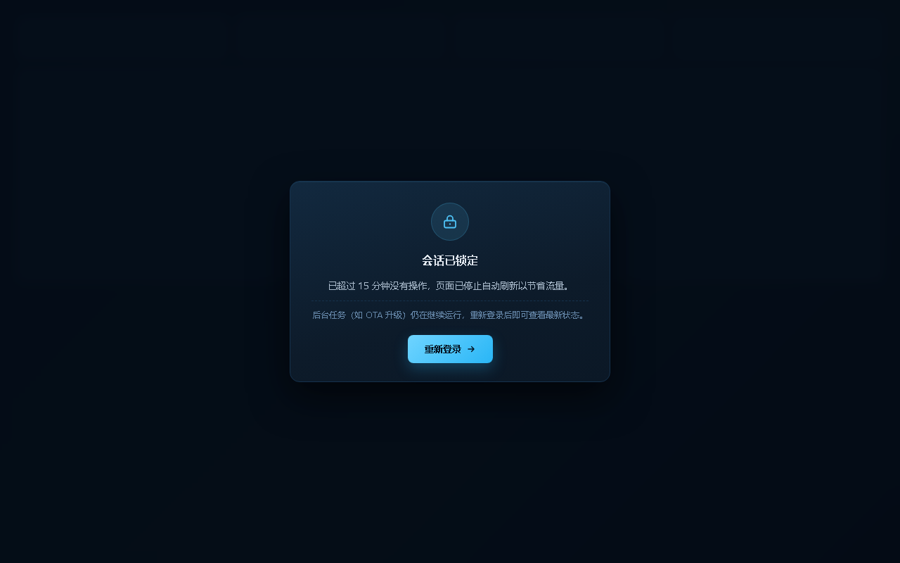

# UPS Sentinel

基于 4G 透传的车载 UPS 远程监控与 OTA 管理平台。MDVR 只做透明管道，协议解析、设备寻址、升级状态机全部收敛在服务端。

技术栈：Rust 2024 / Tokio / Axum 0.8 / Askama / HTMX / DuckDB / Casbin / JWT。

## 能力

- **透明流接入**：MDVR 注册握手（JSON 行或二进制注册帧）后进入纯字节流透传，单连接单写任务，天然避免下行帧交错。探测窗口内若首帧就是状态帧 `a`，直接用载荷里的真实 SN 上线，省掉「占位身份 → 重绑」的迁移。
- **流式协议解析**：`0x7E` 帧同步、`0x7D` 转义解码（严格只解一次）、XOR 校验、半帧/粘包/坏帧重同步，统计帧解析错误率。
- **状态历史**：DuckDB 单写线程 + mpsc 批量 Append；按月分区表 `ups_status_YYYYMM` + 统一视图，过期整分区 `DROP`。设备接入、在线状态、身份重绑同样按 drain 轮次合并为集合式写入（临时表 + `UPDATE/INSERT ... FROM`），上万台同时重连时不会拖死写线程。
- **OTA 协调器**：`S` 开始（3s 内每 100ms 重试）、`D` 64 字节分包（0x30 继续 / 0x31 重发 / 0x32 整轮重来）、`F` 结束；升级期间设备隔离其他下行指令。
- **Web 控制台**：科技感登录页（网格/光环背景 + 实时波形 + MX-UPS 规格展示）、数据分析（按 SN 的历史统计与趋势，服务端 SVG，支持导出 CSV 到桌面）、实时监控（底部固定最近 24 小时概况）、指令下发、固件上传、逐包进度、用户管理、系统设置（含一键重启）。
- **RBAC**：JWT + Casbin（`rbac/model.conf` + `rbac/policy.csv`），模板按钮显隐只是体验优化，真正鉴权在 Axum 中间件。

## 快速开始

### 1. 准备 DuckDB 动态库

`duckdb` crate 需要与版本匹配的原生库（本仓库锁定 DuckDB 1.5.6）。二选一：

```bash
# 方式 A：让构建脚本自动下载预编译库（需要能访问 GitHub）
export DUCKDB_DOWNLOAD_LIB=1

# 方式 B：使用本地预编译库
# 下载 https://github.com/duckdb/duckdb/releases/download/v1.5.6/libduckdb-windows-amd64.zip
# 解压后指定目录（包含 duckdb.lib / duckdb.h / duckdb.dll）
export DUCKDB_LIB_DIR=/path/to/libduckdb
export DUCKDB_INCLUDE_DIR=/path/to/libduckdb
```

运行时 `duckdb.dll` 必须在可执行文件同目录或 `PATH` 中：

```bash
cp /path/to/libduckdb/duckdb.dll target/debug/
```

### 2. 构建与测试

```bash
cargo build
cargo test          # 协议层单元 + 集成测试
```

### 3. 运行

```bash
# 终端 1：平台
UPS_SEED_DEMO=1 cargo run --release

# 终端 2：模拟 MDVR + UPS
cargo run --release --bin simulator
```

打开 <http://127.0.0.1:18080>，使用 `admin / admin123` 登录。

演示账号（`UPS_SEED_DEMO=1` 或 `true` 时创建，**仅用于本地验收，生产不要开启**）：

| 账号 | 密码 | 角色 |
| --- | --- | --- |
| admin | admin123 | admin |
| firmware | firmware123 | firmware_manager |
| operator | operator123 | operator |
| viewer | viewer123 | viewer |

> 生产环境务必修改 `UPS_ADMIN_PASSWORD` 与 `UPS_JWT_SECRET`，并关闭 `UPS_SEED_DEMO`。
> 登录页不再显示任何账号提示，账号信息只在本文件里。

## 端口

| 端口 | 用途 | 环境变量 |
| --- | --- | --- |
| 18080 | Web 管理端 | `UPS_WEB_ADDR` |
| 1688 | MDVR 4G 透传接入 | `UPS_INGEST_ADDR` |

## 配置

全部通过环境变量配置，见 `src/config.rs`。常用项：

| 变量 | 默认值 | 说明 |
| --- | --- | --- |
| `UPS_DB_PATH` | `data/ups.duckdb` | DuckDB 文件 |
| `UPS_FIRMWARE_DIR` | `data/firmware` | 固件包目录 |
| `UPS_RETENTION_DAYS` | `180` | 状态历史保留天数（整月分区删除） |
| `UPS_DOWNLINK_GAP_MS` | `10` | 下行帧最小间隔，协议要求 ≥10ms |
| `UPS_OTA_PACKET_TIMEOUT_MS` | `2000` | 单包应答超时 |
| `UPS_OTA_MAX_RETRIES` | `3` | 0x31 / 超时的单包重试上限 |
| `UPS_OTA_MAX_RESTARTS` | `2` | 0x32 触发的整轮重来上限 |
| `UPS_JWT_SECRET` | `dev-secret-change-me-in-production` | JWT 签名密钥 |
| `UPS_SESSION_IDLE_MIN` | `15` | 控制台空闲超时（分钟），超时后停止刷新并需重新登录 |
| `UPS_ADMIN_USER` / `UPS_ADMIN_PASSWORD` | `admin` / `admin123` | 首次启动创建的管理员 |
| `UPS_DB_THREADS` | 不设 = DuckDB 默认（核数） | DuckDB 线程上限，小规格云主机设 `1` |
| `UPS_DB_MEMORY_LIMIT_MB` | 不设 = DuckDB 默认（内存 80%） | DuckDB 内存上限，1GB 机器建议 `256` |

环境变量只在**首次启动**播种进 `settings` 表，之后以页面为准。

## 系统设置（admin）

`admin` 登录后访问 `/admin/settings`（`src/settings.rs` 的 `CATALOG` 为唯一来源）：

| 分组 | 配置项 | 生效方式 |
| --- | --- | --- |
| 设备接入 | 接入地址、注册探测窗口、下行帧最小间隔、空闲超时、默认上报周期 | 监听地址需重启，其余即时 |
| Web 控制台 | Web 地址、空闲超时、站点标题 | 监听地址需重启，其余即时 |
| 数据 | 保留天数（整月分区删除） | 下次清理周期生效 |
| OTA 升级 | 单包超时、单包重试、整轮重来、`S` 命令等待窗口与轮询间隔 | 即时 |
| 界面 | 显示语言（简体中文 / English） | 即时 |

* 保存走「整批校验、全部通过才落库」，校验失败会按当前语言给出字段级提示；
* 改动监听地址后页面提示「需重启」，重启后进程按 `settings` 表里的地址绑定（回退环境变量）；
* 语言切换即时生效，未收录的英文词条自动回退中文，不会显示空串或键名。
* 「保存配置」旁提供「重启系统」按钮：点击后服务端拉起新实例（延迟 1.2s 等旧进程释放端口与 DuckDB 锁）并退出旧进程，需重启生效的配置随即生效；仅 `admin` 可用。
* 数据分析页「查询」旁提供「导出」按钮：按当前 SN 与时间范围生成 CSV 写入用户桌面，文件名形如 `UPS-192.168.1.169_2026-10-15_0000_2026-10-21_2359.csv`，完成后在页面提示完整路径。首列为可读本地时间 `YYYY-MM-DD HH:MM:SS`（不再输出毫秒时间戳），并带 UTF-8 BOM，Excel 直接打开不乱码。

## 生产部署与维护

上线前逐项确认：

1. **改口令**：`UPS_ADMIN_PASSWORD` 设为强口令（首次启动创建管理员时生效）；已建库则在「用户管理」里改。
2. **改密钥**：`UPS_JWT_SECRET` 设为独立随机串，否则重启会沿用默认签名密钥。
3. **关演示**：`UPS_SEED_DEMO` 不设或设为 `0`，避免创建 `viewer/operator/firmware` 演示账号。
4. **定保留期**：`UPS_RETENTION_DAYS` 决定磁盘占用。实测密度约 18 B/行，30s 上报约 **52 KB/台/天**，
   1 万台按 180 天保留约 91 GB。
5. 启动时会自检上述默认值并打 `WARN` 日志，见到告警即说明还没配好。

### 清空业务数据

交付前或换环境时清掉所有测试/模拟数据（设备、历史样本、固件、OTA 任务、审计日志、非管理员账号），
保留系统设置与管理员账号：

```bash
# 1. 预演：只打印范围，不做修改
mdvr_ups purge

# 2. 停止服务（DuckDB 同一时刻只允许一个写进程）

# 3. 执行
mdvr_ups purge --yes
```

清空后会自动 `CHECKPOINT` 压缩数据库文件，并重建当前月分区与 `ups_status` 视图，
服务下次启动即可直接使用。

### 小规格云主机

响应默认启用 gzip / brotli 压缩（设备树 194 KB → 4 KB）。按流量计费的部署（如 GCP e2-micro
每月 1 GB 出站）必须配合 `UPS_DB_THREADS=1`、`UPS_DB_MEMORY_LIMIT_MB=256`，
详细容量测算与 systemd / 防火墙 / 构建清单见 [docs/deploy-e2-micro.md](docs/deploy-e2-micro.md)。

## 目录结构

```text
src/
  protocol/       帧编解码、nom 流式解析器、命令字与载荷
  ingest/         TCP 接入、注册握手、设备注册表、10ms 下行节流
  storage/        DuckDB 单写线程、分区管理、查询
  ota/            OTA 状态机、ACK 路由、取消与隔离
  web/            Axum 路由、JWT、Casbin 中间件、Askama 视图、SVG 图表、设备树（tree.rs）
  bin/simulator.rs  本地 MDVR + UPS 模拟器
templates/        Askama 模板（HTMX 局部刷新）
rbac/             Casbin model.conf / policy.csv
static/           app.css、shell.js（时钟/树轮询）、monitor.js（树渲染）、htmx.min.js
docs/             协议假设与部署说明
tests/            协议层集成测试
```

## 协议

串口协议按 `docs/UPS串口通讯协议（RS485）v1.4.doc` 实现，命令字是 **ASCII 字母**（`a` 实时状态、`V` 版本、`r`/`u`/`b`/`d`/`f`/`N` 配置、`S`/`D`/`F` 升级），应答沿用原命令字 + 1 字节 ack（`0x30`/`0x31`/`0x32`）。帧结构、字段布局、OTA 时序与实机校验口径见 [docs/protocol.md](docs/protocol.md)。

- `'a'` 帧 28 字节：PWR/VOL/TEM 各 2 字节大端采样值（÷100）、电量、健康状态、20 字节 SN。
- 校验：设备类型..数据正文的异或；文档示例含开始符，**实机不含**，实现按实机口径。
- 平台与 MDVR 之间另有自定义注册约定（JSON 行 / `MDVR|SN` 行 / `cmd=0x80` 帧），不属于串口协议。

## 界面

控制台参考 JT808 CMSV6 风格的深色监控台：顶部为设备/在线/异常/用户四项统计与实时时钟，左侧为功能菜单，实时监控页左侧是设备树、右侧是选中设备的实时信息。

登录页为独立的「科技感」版式：网格背景缓慢漂移、两团呼吸光晕、反方向旋转的虚线光环与竖向扫描线；卡片带 HUD 四角与玻璃质感，左侧品牌区展示实时波形与 MX-UPS-05 规格标签（DC 8–36V / 3.35Ah·49.6Wh / 14.8V），右侧为渐变按钮与发光聚焦的登录表单；窄屏自动堆叠并精简装饰，`prefers-reduced-motion` 下关闭全部动画。

| 登录 | 实时监控（管理员视角，设备树 + 设备面板） |
| --- | --- |
|  |  |

| 设备面板全貌（指令 / 归属 / 历史） | 子用户视角（数据隔离） |
| --- | --- |
|  |  |

| 数据分析 | OTA 升级 | 用户与权限 |
| --- | --- | --- |
|  |  |  |

设备面板按单机版 `UpsManager` 的功能分区重构：

* **设备操作**：查询版本、重启 UPS（二次确认）、写入 SN 码、跳转数据分析；
* **参数设置**：设备地址（0-247）、波特率（协议档位 600–115200）、推送频率（1-3600 秒）逐项设置，提交即组帧下发；
* **最近 24 小时**：面板底部固定展示最近 24 小时的电量曲线与均值/区间统计，不再提供区间选择（任意 SN、任意时间段的深入分析请用「数据分析」页）；
* **OTA**：新增「快速升级」——选择设备与本地固件即可上传并立即开始；设备面板的「发起升级」会自动预选当前设备。

### 可收起的侧边菜单

功能菜单支持像参考项目那样收起：

- 顶栏左侧的汉堡按钮、侧栏标题右侧的箭头按钮都可以切换；收起后菜单变成 56px 图标条，只保留图标、鼠标悬停显示名称，正文区域自动变宽。
- 状态记在 `localStorage`（`ups.menu.collapsed`），刷新与跨页面跳转都保持；`<head>` 里有内联脚本在首帧前应用，避免刷新时先展开再收起。
- 快捷键 `Alt + M` 切换；窗口宽度小于 980px 时默认收起，给表格与图表让出空间。

| 展开（默认） | 收起（图标条） |
| --- | --- |
|  |  |

### 设备树与实时监控

`GET /monitor` 是默认首页（`/` 会重定向到这里），左树右详情：

- 树结构为 **用户 → 设备分组 → 设备**，分组由设备注册时上报的 `group_name` 自动形成，空分组归入「默认分组」。
- 节点右侧显示 `在线数 / 总数`，用户节点按子树汇总；顶部统计条同步「设备 / 在线 / 异常 / 用户」。
- 点击设备后通过 HTMX 把 `GET /devices/{sn}/panel` 载入右侧，面板内的实时指标由 `GET /devices/{sn}/live` 每 3 秒自刷新，曲线来自 `GET /devices/{sn}/history`。
- 树每 20 秒轮询 `GET /api/tree` 更新在线状态与计数（页面切到后台时暂停，切回立即补一次），展开状态存在 localStorage；归属变更后服务端返回 `HX-Trigger: tree-refresh` 让树立即重绘。
- 搜索框支持按 SN / MDVR / 用户名过滤，另有「全部 / 在线 / 离线」过滤。

### 会话与空闲锁定

控制台是**无人值守场景的偶发访问**，所以会话按"空闲"而不是"登录时长"计算：

- 登录令牌有效期 = 空闲窗口（默认 **15 分钟**，「系统设置 → 空闲超时」可调 1–720）。
- 有人操作时，中间件在剩余不足一半时**滑动续期**，一直在用就不会掉线。
- 停手超过窗口：页面停止所有轮询（树 20s、设备实时 3s、OTA 进度 900ms 一并停），盖上锁定遮罩，并调 `/logout` 让服务端会话立即失效；必须重新登录才能继续操作。
- 服务端是兜底：即使前端 JS 被绕过或浏览器关闭，令牌也会在窗口过后失效（API 返回 401，页面 302 到登录页）。
- 锁定只停"刷新"，**不影响后台任务**：OTA 升级、数据入库、设备接入照常进行。



### 用户层级与数据范围

层级以管理员为根：`admin` 是唯一的顶级节点，其余用户全部挂在 `admin` 之下（可以是 `admin` 的直接下级，也可以是下级的再下级），由 `users.parent` 表达。

- **admin 视角**：可见并管理**全部**设备——包括所有用户名下的设备与尚未归属的设备（树上单独挂「未分配设备」节点）。数据分析、OTA 设备下拉、设备树、指令下发都不做过滤。
- **其他用户视角**：只能看到并管理「自己 + 全部子孙用户」名下的设备；同级分支（例如 `fleet_b` 之于 `fleet_a`）完全不可见。
- **范围落到每个入口**：设备树（`/api/tree`）、设备面板 / 实时指标 / 历史曲线、数据分析、OTA 设备下拉与任务列表、指令下发、OTA 发起、任务进度，全部按同一份可见集合过滤，不是只靠模板隐藏按钮。
- **归属维护**：设备面板中的「归属管理」把设备指派给某个用户并设置分组，写库后立即生效；该操作仅 `admin` 可用（`POST /devices/{sn}/assign`）。
- **层级归一化**：启动时会把「无上级」或「上级已被删除」的用户自动挂到 `admin` 下，历史数据无需手工迁移。
- **防环**：调整上级时服务端拒绝「挂到自己的子树下」，下拉框只列出非子树用户；根管理员本身不可被下移。
- **删除保护**：仍有下级用户或仍有设备的用户无法删除，界面直接置灰并给出原因。
- **服务端校验**：越权访问不可见设备返回 404（不泄露 SN 是否存在），越权操作返回 403。


## 权限矩阵

角色继承为 `admin > {firmware_manager, operator} > viewer`，其中 `firmware_manager` 与 `operator` 平级，升级权限与设备控制权限互不包含：

| 能力 | viewer | operator | firmware_manager | admin |
| --- | --- | --- | --- | --- |
| 查看实时监控 / 设备树 / 设备面板 / 历史 / OTA 页面 | ✅ | ✅ | ✅ | ✅ |
| 数据分析导出（CSV 到桌面） | ✅ | ✅ | ✅ | ✅ |
| 下发重启 / 改地址 / 改波特率 / 改上报间隔 | ❌ | ✅ | ❌ | ✅ |
| 上传固件、发起 OTA | ❌ | ❌ | ✅ | ✅ |
| 设备归属调整（指派用户 / 分组） | ❌ | ❌ | ❌ | ✅ |
| 用户与角色管理 | ❌ | ❌ | ❌ | ✅ |

数据范围与角色正交：角色决定「能做什么」，用户层级决定「能看到谁」——`operator` 也不能操作同级分支或未分配的设备；`admin` 既是最高角色，也是层级根节点，因此不受数据范围限制。

已用真实 HTTP 请求逐项验证：`viewer` 的 `POST /devices/*/command`、`POST /ota/start`、`GET /admin/users` 均返回 403；`operator` 仅指令放行；`firmware_manager` 仅 OTA 放行。数据范围实测（4 台设备分属 `fleet_a` / `driver_1` / `fleet_b` / 未分配）：

| 账号 | 树 | 数据分析 | OTA 设备下拉 | 范围外指令 / 历史 |
| --- | --- | --- | --- | --- |
| `admin` | 4 台（含未分配） | 4 | 4 | 放行 |
| `fleet_a`（operator，父 admin） | 2 台 | 2 | 2 | `设备不存在或无权操作` |
| `driver_1`（viewer，父 fleet_a） | 1 台 | 1 | — | 面板 404 |

## 端到端联调

模拟器支持故障注入，用于验证重试与整轮重启：

```bash
# 每 50 包模拟一次 0x31 校验错
SIM_OTA_RETRY_EVERY=50 cargo run --bin simulator

# 第 100 包模拟 0x32 Flash 写入失败，触发整轮重来
SIM_OTA_FLASH_FAIL_AT=100 cargo run --bin simulator

# 多设备
SIM_SN=UPS-9002 SIM_MDVR=MDVR-002 cargo run --bin simulator
```

## 生产部署要点

- 接入端口暴露在公网时，建议在 MDVR 侧使用固定 IP 白名单或 TLS 终止代理；注册帧本身不含密钥，必要时在握手阶段扩展鉴权字段。
- DuckDB 为单进程内嵌库，本设计由单写线程串行化访问；若要多实例部署，请改为每实例独立库或迁移到服务端数据库。
- `/metrics` 为 Prometheus 文本/JSON 指标端点，默认未鉴权，请在内网暴露。
- 审计日志写入 `audit_log` 表（登录、指令、固件上传、升级结果）。
- JWT 存于 HttpOnly Cookie；跨站部署时请补充 CSRF token。
